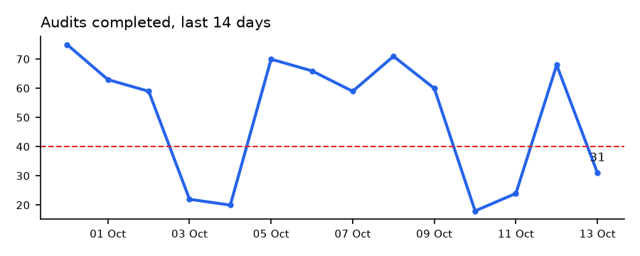

# kpibot


Sends a daily KPI summary to a Telegram group: yesterday's numbers, the change since the day before and the same
day last week, alerts when something crosses a threshold, and a 14-day chart.

Field managers don't open dashboards at 07:30. They do read Telegram. I've run QC summaries this way at work,
and this is a standalone, configurable version: you describe each KPI as a SQL query in a TOML file and the bot does
the rest.

```
Field execution: daily summary
Tuesday 13 October 2026

Needs attention
• Audits completed: below 40
• QC pass rate: below 85.0

Audits completed  31 audits
  vs yesterday ▼ -54.4% ⚠   vs last week ▼ -53.0% ⚠
QC pass rate  61.3%
  vs yesterday ▼ -30.5% ⚠   vs last week ▼ -31.4% ⚠
Order value  R 176 152
  vs yesterday ▲ +49.6%   vs last week ▲ +54.2%
Cancellation rate  8.1%
  vs yesterday ▼ -35.5%   vs last week ▼ -32.3%
```



## Defining KPIs

```toml
[[kpi]]
name = "Cancellation rate"
unit = "%"
decimals = 1
higher_is_better = false    # a drop is good news, so it isn't marked ⚠
alert_above = 15
chart = true
sql = """
select placed_on, 100.0 * sum(status = 'cancelled') / count(*) from orders
where placed_on between :start and :end
group by placed_on
"""
```

Each query gets `start` and `end` dates and returns one row per day: `(day, value)`. Works with SQLite or
PostgreSQL. See [kpibot.example.toml](kpibot.example.toml).

## Details that matter in practice

- **The "worse" marker follows the KPI's direction.** Cancellations going up gets ⚠, going down doesn't.
  Telegram can't colour text, so the marker has to carry that meaning.
- **One broken query doesn't kill the report.** That KPI shows "could not be calculated" and appears under Needs attention.
- **Missing days stay missing.** A day with no data is `n/a` and a gap in the chart, not a misleading zero.
- **Telegram limits are handled.** Messages over 4 096 characters are split on line breaks, so an HTML tag is
  never cut in half. On a `429` it waits the `retry_after` Telegram asks for, and 5xx errors and network failures
  back off and retry.
- **The bot token is never logged.** It's read from an environment variable, and error messages are built from
  Telegram's response, not the request URL (which contains the token).
- **Names are HTML-escaped**, so a KPI called `Spaza <Gauteng> & KZN` doesn't break the message.
- `--day 2026-10-12` resends a specific day's report if the server was down.

## Running it

```
pip install -e .[charts]
python demo/make_demo_db.py
python -m kpibot kpibot.example.toml --dry-run
```

To send for real, create a bot with @BotFather, add it to your group, copy the example config to
`kpibot.toml` with your chat id, then:

```
export TELEGRAM_BOT_TOKEN=123456:ABC...
python -m kpibot kpibot.toml              # send once (yesterday)
python -m kpibot kpibot.toml --daemon     # keep running, send daily at send_at
```

Or skip `--daemon` and schedule the one-off command with cron or Windows Task Scheduler.

## Tests

```
pip install -e .[test]
pytest
```

The tests cover comparisons and gaps, alerts, failed queries, number formatting, direction-aware markers,
HTML escaping, message splitting, 429 handling with `retry_after`, the token staying out of errors, sending to
every chat, and the schedule.
